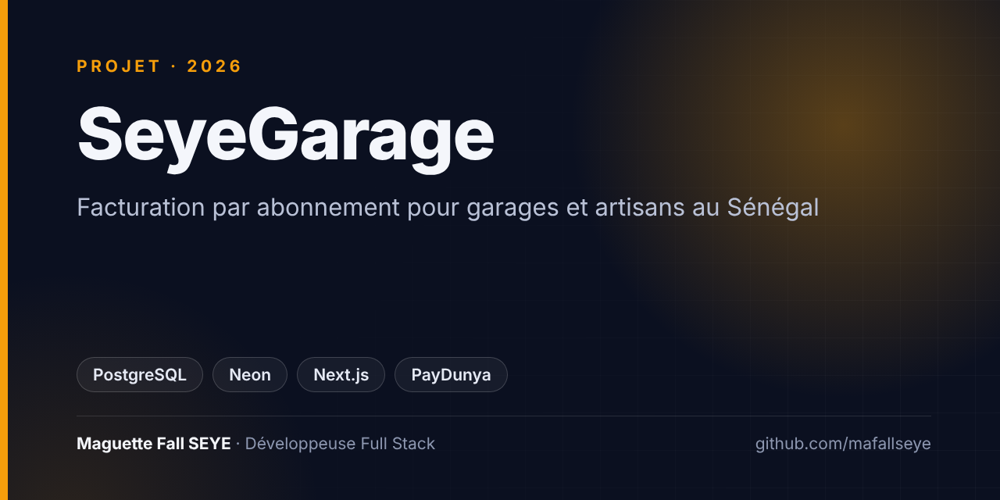

# SeyeGarage

Plateforme de facturation par abonnement pour garages, menuiseries et autres métiers (Sénégal).

- Un compte (email) → plusieurs entreprises → un abonnement par entreprise
- Pro forma → bon de réception → facture (acquittée si tout est payé), PDF
- Historique exportable en Excel
- Paiement : PayDunya (Wave, Orange Money, carte)

## Équipe
Trois agents IA : Maguette (développement), Safia (design), Karim (relecture). Voir `DOSSIER_AGENTS.md`.

## État
- [x] Base de données PostgreSQL (Neon, Frankfurt) avec règles de sécurité (`db/001_schema.sql`), testé
- [ ] Application web (Next.js)
- [ ] Génération PDF et export Excel
- [ ] Paiement PayDunya
